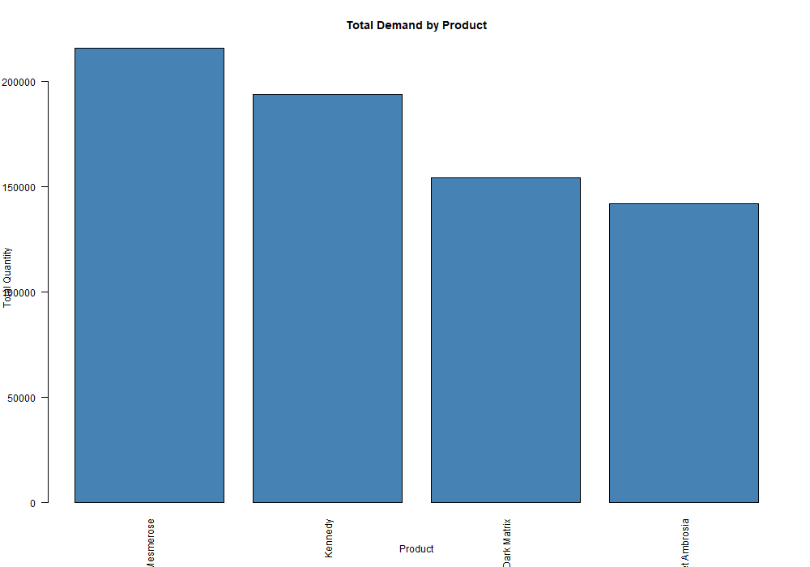
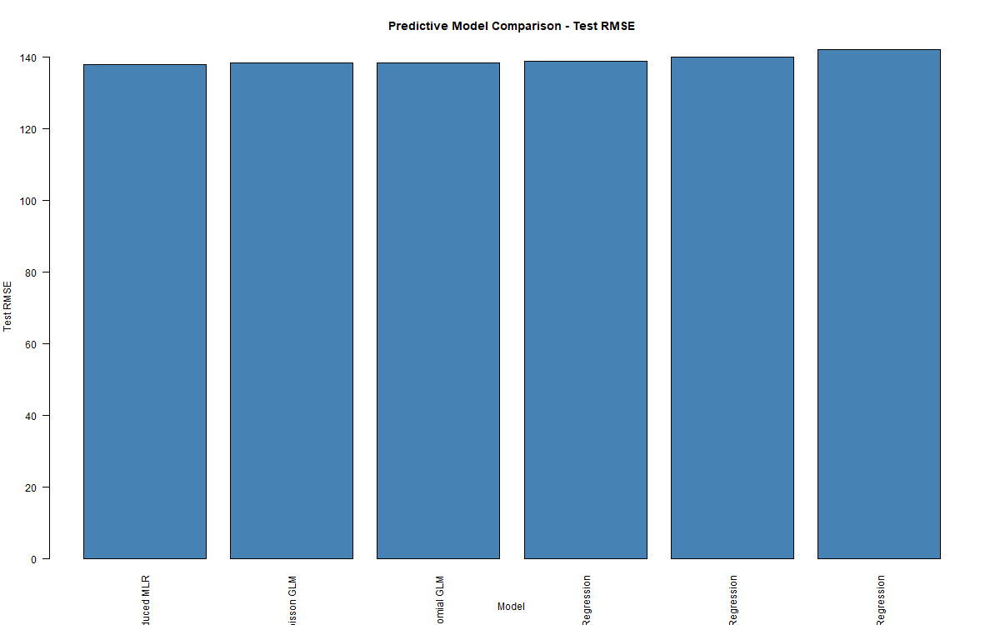
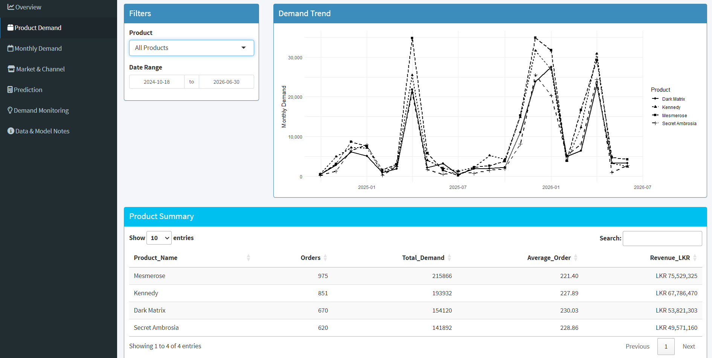
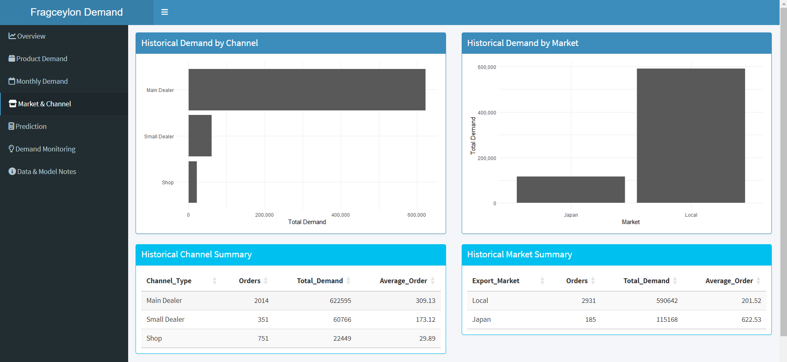
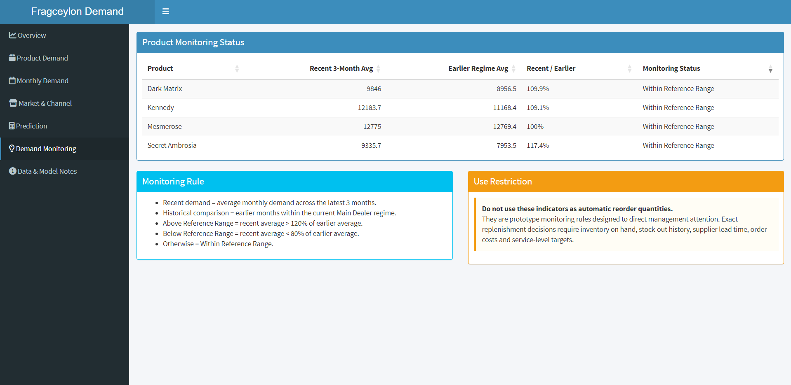

# Retail Product Demand Analysis at Fragceylon

**IT3081 – Statistical Modelling | Industry Innovation Consultancy Project**  
**BSc (Hons) Data Science · Department of Computer Science · Faculty of Computing · Sri Lanka Institute of Information Technology (SLIIT)**

> **From historical perfume sales to evidence-based demand and inventory decisions.**

This repository documents an applied statistical consultancy project investigating retail product demand at **Fragceylon**. Using historical sales records, our team examined demand patterns, tested statistical hypotheses, compared predictive models, and developed an **R Shiny demand-monitoring and decision-support dashboard**.

**Project focus:** Retail demand analysis · Statistical inference · Regression and GLMs · Business decision support · R Shiny

## 1. The business problem

Perfume demand varies across products, markets, sales channels, and time. For a retailer or distributor, these variations can complicate purchasing decisions, product availability, and inventory planning.

Our objective was to determine what the historical data can **reliably** tell Fragceylon about recorded demand, which statistical models can estimate transaction-level order quantity, and how those insights could support management. Because the study uses observational records, identified associations are **not automatically causal effects**.

## 2. Dataset overview

| Item | Description |
|---|---|
| Source | Historical business sales records supplied for the academic consultancy project |
| Coverage | 18 October 2024 – 30 June 2026 |
| Total records | **5,481** |
| Commercial regular-order records | **3,116** |
| Free-sample records | **2,365** |
| Products | **Mesmerose, Kennedy, Secret Ambrosia, Dark Matrix** |
| Markets | Local and Japan |
| Recorded sales channels | Shop, Small Dealer, Main Dealer |
| Main response variable | **Quantity** ordered per regular-order record |

**Important preprocessing decision:** Free samples were analysed separately and were **not included** in the main commercial-demand hypothesis tests or predictive models. An important business/channel-structure change occurred around **1 April 2025** and was considered in the analysis.

> **Data access:** The company-provided raw and cleaned workbooks are excluded from the public repository. They are not included as downloadable public research data. Reproducing the analyses or running the dashboard requires an authorized local copy of the relevant files.

## 3. Analytical workflow

1. **Data preparation and descriptive analysis:** Audited dates, categories, missing values, duplicates, unusual quantities and revenue consistency; summarised demand by product, market, channel, and month.
2. **Statistical inference:** Used ANOVA, Welch tests, variance comparisons, confidence intervals, and effect sizes where appropriate.
3. **Predictive modelling:** Compared a baseline and candidate models, including Multiple Linear Regression, Poisson and Negative Binomial GLMs, Ridge, LASSO, and Elastic Net.
4. **Model validation:** Used a chronological training/test split, model diagnostics, and holdout performance measures.
5. **Additional statistical perspectives:** Critically evaluated Completely Randomized Design (CRD), Randomized Complete Block Design (RCBD), PCA, Bayesian methods, and time-series forecasting. Selected exploratory or illustrative demonstrations were produced; these should **not** be mistaken for completed business experiments or deployed forecasting systems.
6. **Industry innovation:** Created an R Shiny prototype bringing together demand monitoring, model estimates, and management-facing summaries.

## 4. Selected findings

### Descriptive and inferential results

- **705,810 units** were recorded across regular orders during the study period.
- **Mesmerose** had the highest recorded *total* regular-order quantity (**215,866 units**, approximately **30.6%** of the four-product total).
- The one-way product ANOVA found **no statistically significant difference in mean quantity per regular-order record** across the four perfumes: **F(3, 3112) = 0.382, p = 0.766**. Total volume and average transaction size answer different questions.
- In a restricted comparison within the same buyer and current Main Dealer regime, mean order quantity was higher for **Japan (622.53 units)** than **Local (283.70 units)**; the Welch test gave **p < 0.001**. This is an **observational association**, not evidence that market location causes the difference.



### Predictive model comparison

The primary predictive task estimated **quantity for an individual future regular-order transaction**, not future monthly sales totals. Models were fitted using the post-April-2025 operating regime, with **April–June 2026 held out for testing**.

| Model | Test RMSE (units) |
|---|---:|
| **Reduced Multiple Linear Regression** | **137.95** |
| Poisson GLM | 138.27 |
| Negative Binomial GLM | 138.27 |
| Elastic Net | 138.84 |
| LASSO | 140.05 |
| Ridge | 142.20 |
| Training-mean baseline | 178.34 |

The selected **Reduced Multiple Linear Regression** model used **Product, Export Market, and Day of Week** as predictors. It achieved **test MAE = 116.84 units**, **test R² = 0.399**, and approximately **22.65% lower test RMSE than the baseline**. Its advantage over the two GLMs was small, so interpretability and limitations were also considered in selection.



## 5. Fragceylon R Shiny dashboard

An interactive **local R Shiny prototype** was developed to make the analysis accessible to decision-makers. It includes seven sections:

- **Overview:** Key demand and revenue indicators.
- **Product Demand:** Product comparisons and demand trends.
- **Monthly Demand:** Historical monthly patterns and time-series limitations.
- **Market & Channel:** Segmentation of historical orders.
- **Prediction:** Transaction-level order-quantity estimates and model performance.
- **Demand Monitoring:** Prototype alerts for unusual recent demand relative to an earlier reference period.
- **Data & Model Notes:** Methodological cautions and future data requirements.

### Dashboard screenshots

**Product demand**



**Market and channel analysis**



**Demand monitoring**



> **Prototype, not an automated inventory system:** The dashboard does not calculate exact reorder quantities. Stock on hand, stock-outs, supplier lead times, replenishment costs, and related variables are not fully available. Monitoring indicators are prompts for management review, not automatic purchasing instructions.

**Deployment status:** The dashboard is demonstrated through screenshots and can be run locally in RStudio; a publicly hosted version is not required to view the project results in this repository.

## 6. Repository guide

```text
01_Assignment_Brief/       Assignment specification
02_Company_Information/   Confidential organizational materials (excluded from public Git tracking)
03_Raw_Data/              Confidential source dataset (excluded from public Git tracking)
04_Cleaned_Data/          Local cleaned/analysis data (excluded from public Git tracking)
05_Analysis/R/            R scripts for statistical tasks
05_Analysis/RMarkdown/    R Markdown analysis documents
06_Charts/R/              Statistical charts and model plots
07_Literature/            Literature working folder
08_Model_Results/R/       Saved statistical tables, diagnostics, and summaries
09_Dashboard/             R Shiny application and screenshots
10_Industry_Validation/   Industry feedback working folder
11_Report/                Consultancy report
12_Presentation/          Presentation working folder
```

## 7. Running the project locally

**Requirements:** R, RStudio, and the relevant R packages. The dashboard uses `shiny`, `shinydashboard`, `readxl`, `dplyr`, `ggplot2`, `DT`, and `scales`.

1. Clone or download this repository.
2. Obtain the company datasets **only with authorization** and place them in the expected local folders.
3. For the full analysis, update the computer-specific `setwd(...)` statements in the scripts under `05_Analysis/R/` to point to your local project folder. The `00_Run_All_Tasks_3_4_5.R` script calls the cleaning, descriptive, inference and main modelling scripts in sequence.
4. In RStudio, open the project and run `09_Dashboard/00_install_dashboard_packages.R` if required.
5. Ensure the authorized file `04_Cleaned_Data/Fragceylon_Regular_Orders.xlsx` is present, then open `09_Dashboard/app.R` and click **Run App**.

The dashboard code looks for the project folder containing `04_Cleaned_Data/Fragceylon_Regular_Orders.xlsx`. A clone without the private workbook cannot launch the data-dependent dashboard; the saved charts, selected model outputs, and dashboard screenshots remain available for review.

## 8. Limitations and responsible use

- Results are based on observational records and should **not** be interpreted as causal effects.
- Sales-channel patterns are affected by the structural change around April 2025.
- The stable operating regime covers only **15 months**, insufficient for dependable claims about annual seasonality.
- The model estimates **transaction-level quantity**, with meaningful forecast uncertainty; it is not a stock-replenishment optimizer.
- Detailed customer, inventory, promotion, and supplier information is incomplete.
- Statistical findings and visuals should only be shared publicly with the organization's approval; the absence of a public dataset does **not** grant reuse rights.

## 9. Academic context

Developed as a group statistical consultancy project for **IT3081 – Statistical Modelling**, part of the **BSc (Hons) Data Science** degree programme at the **Department of Computer Science, Faculty of Computing, Sri Lanka Institute of Information Technology (SLIIT)**.

The project demonstrates how statistical evidence, critical evaluation of methods, and practical software prototypes can support informed retail decision-making.

---

**Repository:** [IT3081-Fragceylon-Retail-Demand-Analysis](https://github.com/PabodaFdo/IT3081-Fragceylon-Retail-Demand-Analysis)
